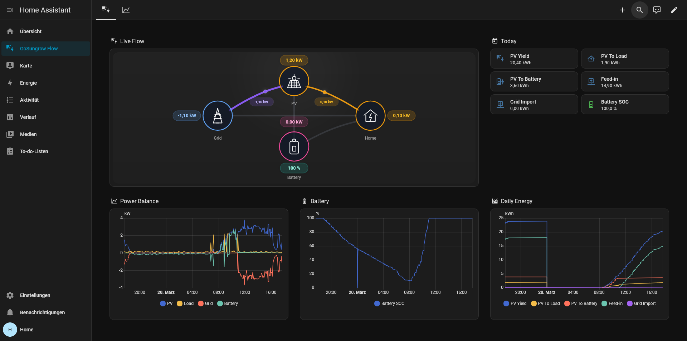
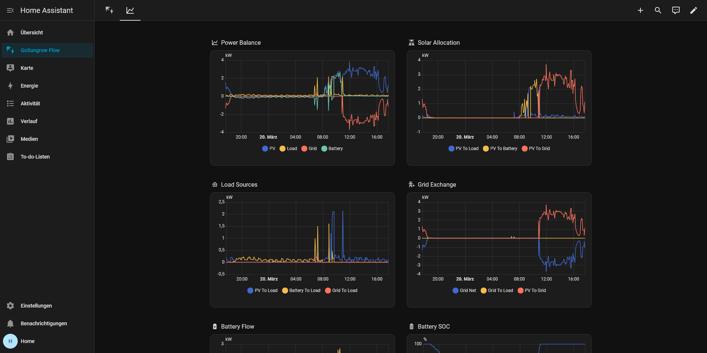

# GoSungrow Home Assistant App

Custom Home Assistant app for Sungrow iSolarCloud.

The authoritative behavioral contract for the program is [`specs/README.md`](specs/README.md). This README is user-facing guidance; changes to program behavior are specified there first.

GoSungrow logs in to iSolarCloud, publishes entities to Home Assistant through MQTT discovery, and installs managed dashboards for live flow and trends.

This repository is based on the original [MickMake/GoSungrow](https://github.com/MickMake/GoSungrow) project and is maintained by [Andreas Roth](https://github.com/roth-andreas) with a focused Home Assistant app deployment model.


## Screenshots

<p align="center">
  
  
</p>

## Requirements

- Home Assistant installation with app support
- a working MQTT broker and the Home Assistant `MQTT` integration
- an iSolarCloud account
- outbound network access from Home Assistant to iSolarCloud

## Quick Start

1. Install and start the `Mosquitto broker` app in Home Assistant.
2. Confirm `MQTT` appears under `Settings > Devices & services`.
3. Go to `Settings > Apps > App Store`.
4. Open the three dots menu in the top-right corner and choose `Repositories`.
5. Click `+ Add repository` and paste:

   ```text
   https://github.com/roth-andreas/gosungrow-home-assistant
   ```

6. Click `Add`, then return to the `App Store`.
7. Search for `GoSungrow`, open it, and click `Install`.
8. Open the `Configuration` tab and enter your `gosungrow_user` and `gosungrow_password`.
9. Make sure MQTT is available:
   - For the Home Assistant Mosquitto broker, install/start Mosquitto and enable the MQTT integration.
   - For an external broker, set `mqtt_host`, `mqtt_port`, `mqtt_username`, and `mqtt_password`.
10. Start the app.
11. Open the automatically created `GoSungrow Flow` dashboards from the sidebar.

For almost everyone, the only app settings you need are:

- `gosungrow_user`
- `gosungrow_password`
- `gosungrow_host` (optional): supported regional iSolarCloud gateway; Indian accounts can select `https://gateway.isolarcloud.in`

## What You Get

- MQTT-discovered Sungrow entities in Home Assistant
- one stable plant-level live PV entity that uses a native plant total or a complete AC/DC sum across producer devices
- a managed `Overview` dashboard for live flow and daily summary
- a managed `Trends` dashboard for deeper energy analysis
- support for `aarch64` and `amd64`

## Configuration

Required:

- `gosungrow_user`
- `gosungrow_password`

Optional:

- `install_dashboard`
- `dashboard_language` (`auto`, `en`, `de`, `sv`, `es`)
- `debug`

Everything else is handled internally by the app:

- the standard iSolarCloud host
- the required app key
- Home Assistant MQTT service wiring
- the managed dashboard URL and title
- dashboard language follows Home Assistant UI language when available (fallback: English)

The app documentation is in `addon/gosungrow/DOCS.md`.

## Notes

- GoSungrow needs a working MQTT broker. With `mqtt_host` empty, it waits up to two minutes at startup for the Home Assistant Supervisor MQTT service. Set `mqtt_host` to use a custom broker directly.
- Temporary iSolarCloud login or gateway failures recover automatically on later sync attempts. GoSungrow retains the last successful gateway and MQTT values, authenticates again when required, and refreshes device discovery before publishing resumes.
- The app manages its own dashboard automatically.
- Daily values with unverified automatic sources are withheld, including their history and tooltips. Otherwise usable unverified manual selections keep a persistent warning; proven incompatible values remain withheld. Selections stay available in **Data Sources** for review. Adopting a verified replacement uses its own history and leaves recorder data untouched.
- Multi-inverter plants use the canonical plant PV source when GoSungrow can establish a complete, single-basis total. Its default name is `sensor.gosungrow_virtual_<plant-id>_pv_power`; registry identity also finds renamed or suffixed entities. Existing manual selections remain unchanged and pinned automatic sources receive a reviewable recommendation.
- While dashboard installation is enabled, the app watches relevant Home Assistant changes throughout its lifetime. Sources that appear after startup are reconsidered automatically, with serialized updates and bounded retries. Home Assistant observation does not force an iSolarCloud login.
- If iSolarCloud denies access to a plant tree, the app can use verified device inventory to install or refresh the dashboard. Dashboard updates wait when any target cannot be verified. Eligible readings continue updating through MQTT.
- Microinverters (type 55) are included. Device sums require every independently discovered producer leaf; missing readings never become zero or a partial total. The `Plant PV aggregation:` info log explains publication or suppression without enabling HTTP tracing.
- If you are updating from an older version with more options, open the app configuration once and save it to clear legacy fields.
- The repository also includes `examples/home-assistant-energy-cards.yaml` if you want to build a dashboard around Home Assistant's official Energy cards.

## Credit

- Original GoSungrow reverse engineering and codebase: MickMake
- Home Assistant app packaging and maintenance in this repository: [Andreas Roth](https://github.com/roth-andreas)

## Battery power in Live Flow

The reading beside the battery icon is captioned **Battery power**. For automatic values calculated from directional flows, positive means net discharge and negative means net charge. The published legacy MQTT `battery_power` sensor uses the opposite sign. A manually selected battery sensor keeps its own value and sign.

Automatic node totals require every directional operand to be valid and have compatible power units. With incomplete flows, a verified direct source can supply the node; otherwise it stays unavailable. The legacy battery sensor is not used as an automatic fallback with the wrong sign. A missing manual source stays unavailable rather than falling back to another value.

The direction text uses the solar-to-battery and battery-to-home flows independently of the selected battery reading. It shows Charging, Discharging, Idle, Balanced flows, or Direction unavailable. Matching route values are hidden when the other battery route is available and inactive; distinct active route values remain visible in the wide layout. Compact layouts retain battery information while omitting route labels.

When reporting a battery flow problem, capture the Live Flow display and the Data Sources selections for Battery power, Solar to battery power, and Battery to home power together. Include each selected entity ID, its current value and unit, whether it is automatic or manual, and the displayed battery value and direction. Use Home Assistant entity details to capture live values; avoid sharing credentials or tokens.
